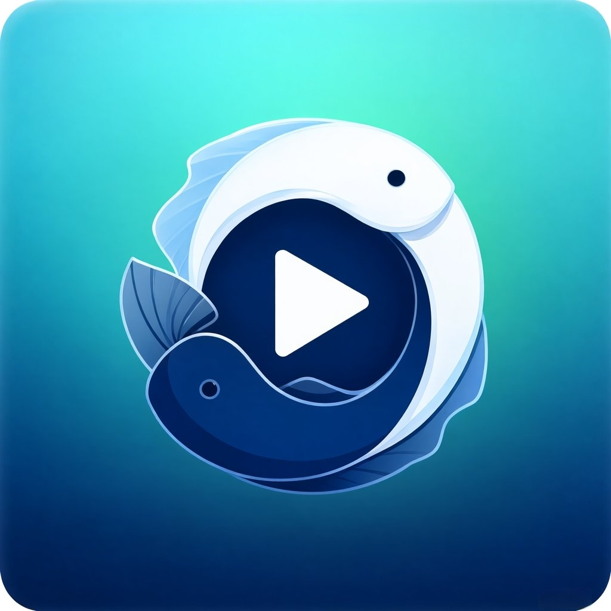
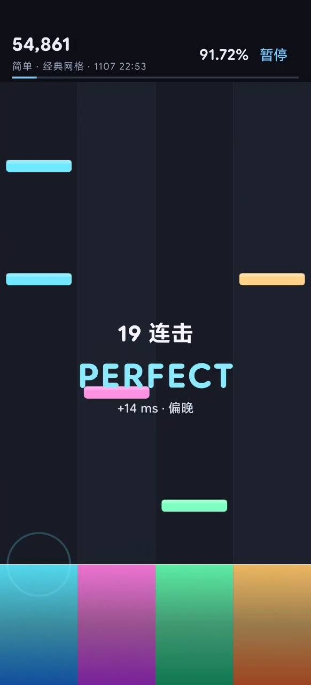
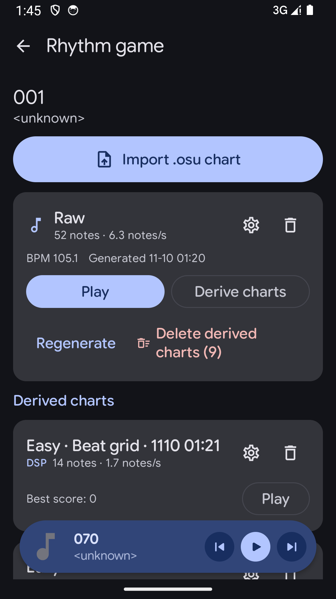

<p align="center">
  
</p>

<p align="center">
  <a href="https://github.com/pisces312/PixelPlayerOSS/releases/latest">
    
  </a>
  <a href="https://github.com/pisces312/PixelPlayerOSS/releases">
    
  </a>
  <a href="https://github.com/sponsors/lostf1sh">
    
  </a>
  
  
</p>

<p align="center">
  
  
  
  
</p>

## What It Is

PiscesPlayer is an Android music player with a built-in rhythm game. It is maintained by [@pisces312](https://github.com/pisces312) and is based on [PixelPlayerOSS](https://github.com/PixelPlayerHQ/PixelPlayerOSS), the upstream FOSS player maintained by [@lostf1sh](https://github.com/lostf1sh). It focuses on local playback, self-hosted music libraries, expressive Material 3 UI, user-controlled online lookups, and turning any song into a playable rhythm chart.

PiscesPlayer ships under its own package name (`com.pisces312.piscesplayer`) and is signed with a different key, so it installs side by side with upstream or F-Droid builds of PixelPlayerOSS — see [Release builds](#release-builds).

The app works offline by default. Optional online services are disabled until you enable them in setup or settings.

Package name: `com.pisces312.piscesplayer`

## Why This Exists

PiscesPlayer keeps the player FOSS-oriented and removes integrations that are not part of that direction.

Removed integrations include Telegram, NetEase, QQ Music, Google Drive, Gemini, Cast, Wear OS, Play Store billing, Firebase, Crashlytics, and Google Play Services runtime dependencies.

Cloud playback is limited to self-hosted sources: Navidrome/Subsonic and Jellyfin.

## Features

| Area | Highlights |
| --- | --- |
| Playback | Media3 playback engine, FFmpeg support, gapless playback, crossfade, custom transitions, queue controls, shuffle, repeat, sleep timer, external file playback |
| Library | Local scanning for MP3, FLAC, AAC, OGG, WAV, M4A, albums, artists, genres, folders, favorites, playlists, stats, metadata editing |
| Self-hosted | Navidrome/Subsonic and Jellyfin login, sync, streaming, artwork, and app-private offline downloads |
| Rhythm game | One-tap master chart generation from any song, Easy/Normal/Hard derivations, latency calibration, scroll speed, note density, and play-logic presets |
| Lyrics | Embedded lyrics, local `.lrc` files, lyrics import/editing, optional LRCLIB lookup |
| Artwork | Local artwork, album-art palette extraction, optional Deezer artist image lookup |
| Metadata | On-demand MusicBrainz matching for recording, release, and artist identifiers |
| UI | Jetpack Compose, Material 3, dynamic color, light/dark themes, Glance widgets, animated player surfaces |
| Backup | Preferences, playlists, favorites, lyrics, stats, and app state backup/restore |

## Online Services

PiscesPlayer separates offline playback from network lookups.

| Service | Purpose | Default |
| --- | --- | --- |
| Navidrome/Subsonic | Self-hosted library sync, streaming, and offline downloads | User login required |
| Jellyfin | Self-hosted library sync, streaming, and offline downloads | User login required |
| MusicBrainz | On-demand metadata matching and identifier enrichment | Only when requested |
| LRCLIB | Search online lyrics when local or embedded lyrics are missing | Off |
| Deezer | Fetch missing artist artwork and cache it locally | Off |

LRCLIB and Deezer can be enabled during first-run setup or later from `Settings > Music Management > Optional online services`. MusicBrainz searches run only when you choose the lookup action for a track.

## Requirements

| Requirement | Version |
| --- | --- |
| Android | 11 or newer, API 30+ |
| JDK | 21 |
| Android SDK | compile/target 37 |

## Build From Source

Clone the repository:

```sh
git clone https://github.com/pisces312/PixelPlayerOSS.git
cd PixelPlayerOSS
```

Build the debug APK:

```sh
JAVA_HOME=/usr/lib/jvm/java-21-openjdk ./gradlew :app:assembleDebug
```

Build one universal debug APK for local installation:

```sh
JAVA_HOME=/usr/lib/jvm/java-21-openjdk ./gradlew :app:assembleDebug -Ppixelplayer.enableAbiSplits=false
```

Build a universal unsigned release APK suitable for F-Droid verification:

```sh
JAVA_HOME=/usr/lib/jvm/java-21-openjdk ./gradlew :app:assembleRelease -Ppixelplayer.enableAbiSplits=false -Ppixelplayer.disableReleaseSigning=true
```

Run unit tests:

```sh
JAVA_HOME=/usr/lib/jvm/java-21-openjdk ./gradlew :app:testDebugUnitTest
```

Generate the baseline profile with a connected device or emulator:

```sh
JAVA_HOME=/usr/lib/jvm/java-21-openjdk ./gradlew :baselineprofile:generateBaselineProfile
```

## Download

APKs are published on the GitHub releases page:

```text
https://github.com/pisces312/PixelPlayerOSS/releases
```

Obtainium app id:

```text
com.pisces312.piscesplayer
```

Releases are cut from `main` once a batch of changes is ready, rather than on a fixed cadence.

### Release builds

Releases are cut by hand from `main` and published on the [releases page](https://github.com/pisces312/PixelPlayerOSS/releases) as `X.Y.Z-pisces.N`. There is no automated pre-release pipeline here, so no `vX.Y.Z-alpha.N` builds are published — expect the `-pisces.N` line only.

To install one, download the APK from the release assets and sideload it: `arm64-v8a` is the only ABI built.

Release builds are signed with a personal key, so they update over each other. PiscesPlayer uses its own package name and signing key, so it cannot be installed over a PixelPlayerOSS build (upstream or F-Droid) and vice versa; moving a library between them uses the in-app backup and restore.

## Support

PiscesPlayer is a hobby fork. If the player is useful to you, the best way to support it is to support the upstream project: [GitHub Sponsors of @lostf1sh](https://github.com/sponsors/lostf1sh).

## Project Structure

```text
app/src/main/java/com/pisces312/piscesplayer/
- data/             Room, repositories, preferences, services, workers
- di/               Hilt modules and qualifiers
- presentation/     Compose screens, components, navigation, ViewModels
- ui/               Theme and Glance widgets
- utils/            Shared utilities

baselineprofile/      Macrobenchmark and baseline profile generation
```

## Tech Stack

| Area | Technology |
| --- | --- |
| Language | Kotlin |
| UI | Jetpack Compose |
| Design | Material 3 |
| Playback | AndroidX Media3, ExoPlayer, FFmpeg |
| Database | Room |
| Dependency Injection | Hilt |
| Preferences | DataStore |
| Background Work | WorkManager |
| Networking | Retrofit, OkHttp |
| Images | Coil |
| Metadata | TagLib |

## Contributing

Contributions are welcome. Open an issue or pull request with a focused change and include test/build results when possible.

Useful local checks:

```sh
JAVA_HOME=/usr/lib/jvm/java-21-openjdk ./gradlew :app:compileDebugKotlin
JAVA_HOME=/usr/lib/jvm/java-21-openjdk ./gradlew :app:lintDebug
JAVA_HOME=/usr/lib/jvm/java-21-openjdk ./gradlew :app:testDebugUnitTest
```

Release process: [docs/RELEASE.md](docs/RELEASE.md)

F-Droid notes (historical, the fork is not distributed via F-Droid): [docs/FDROID.md](docs/FDROID.md)

Privacy policy: [PRIVACY.md](PRIVACY.md)

Security policy: [SECURITY.md](SECURITY.md)

## License

PiscesPlayer is licensed under the [GNU General Public License v3.0](LICENSE) (`SPDX-License-Identifier: GPL-3.0-or-later`). It is a modified version of PixelPlayerOSS by Theo Vilardo (@lostf1sh); see [NOTICE](NOTICE).

```
PiscesPlayer
Copyright (C) 2026 pisces312
Based on PixelPlayerOSS, Copyright (C) 2026 Theo Vilardo

This program is free software: you can redistribute it and/or modify
it under the terms of the GNU General Public License as published by
the Free Software Foundation, either version 3 of the License, or
(at your option) any later version.

This program is distributed in the hope that it will be useful,
but WITHOUT ANY WARRANTY; without even the implied warranty of
MERCHANTABILITY or FITNESS FOR A PARTICULAR PURPOSE.  See the
GNU General Public License for more details.

You should have received a copy of the GNU General Public License
along with this program.  If not, see <https://www.gnu.org/licenses/>.
```

Distributed APKs include third-party components under their own licenses. In particular, the optional FFmpeg decoder dependency `org.jellyfin.media3:media3-ffmpeg-decoder` is GPL-3.0; see [THIRD_PARTY_NOTICES.md](THIRD_PARTY_NOTICES.md).

<p align="center">
  Fork maintained by <a href="https://github.com/pisces312">pisces312</a> · upstream <a href="https://github.com/lostf1sh">PixelPlayerOSS</a> maintained by <a href="https://github.com/lostf1sh">lostf1sh</a>
</p>
<p align="center">
  Original PixelPlayerOSS logo designed by <a href="https://github.com/NPSummers">Aureal</a>. PiscesPlayer icon by pisces312.
</p>
