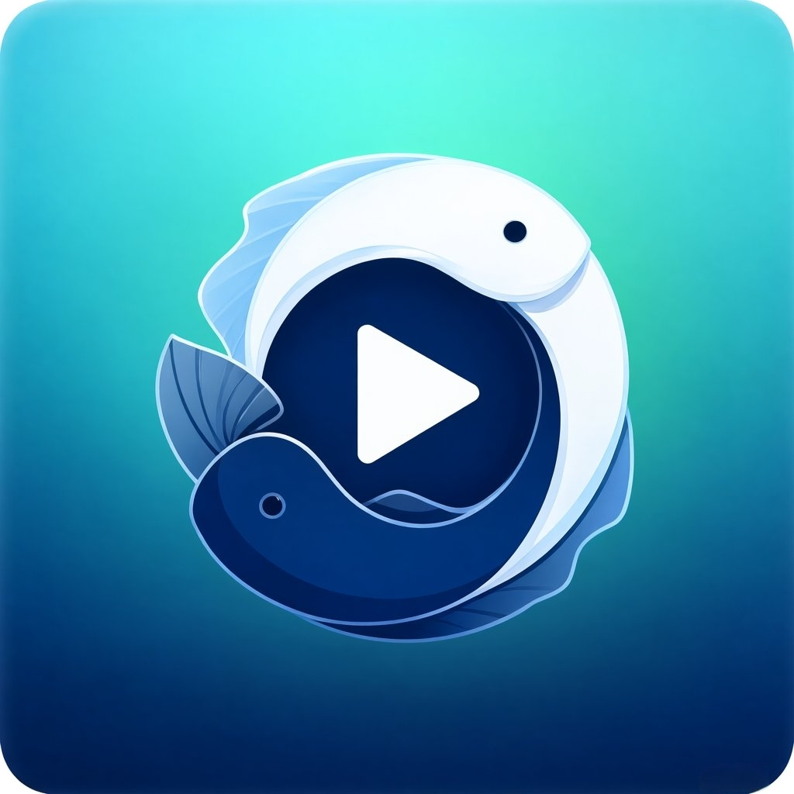
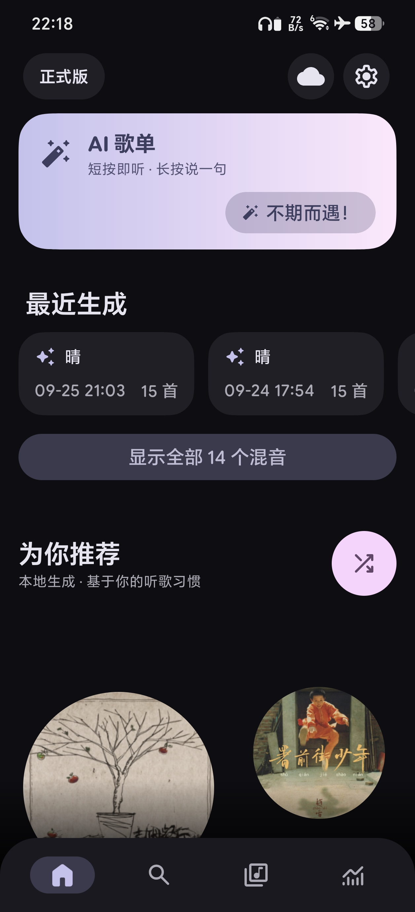
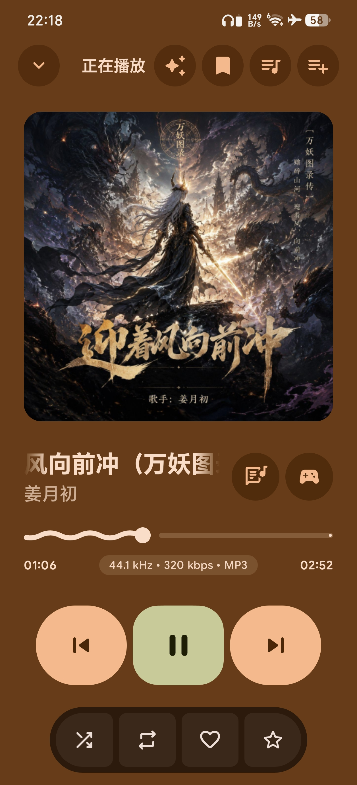
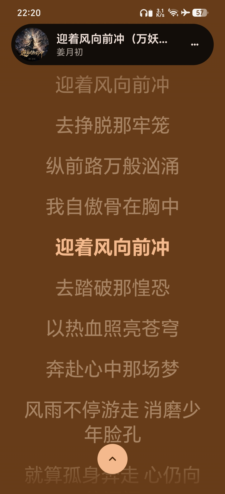
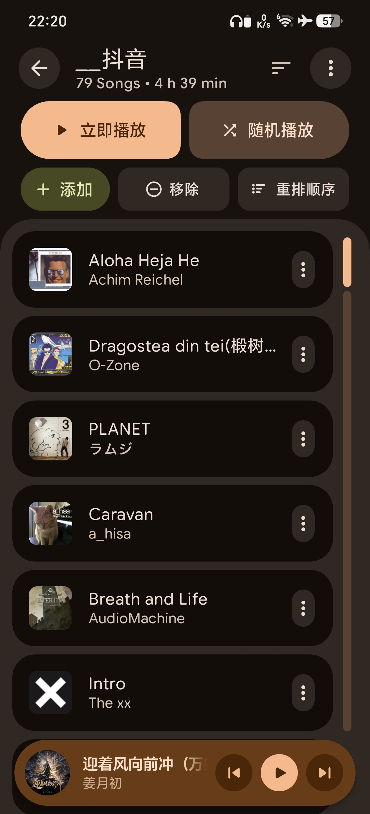
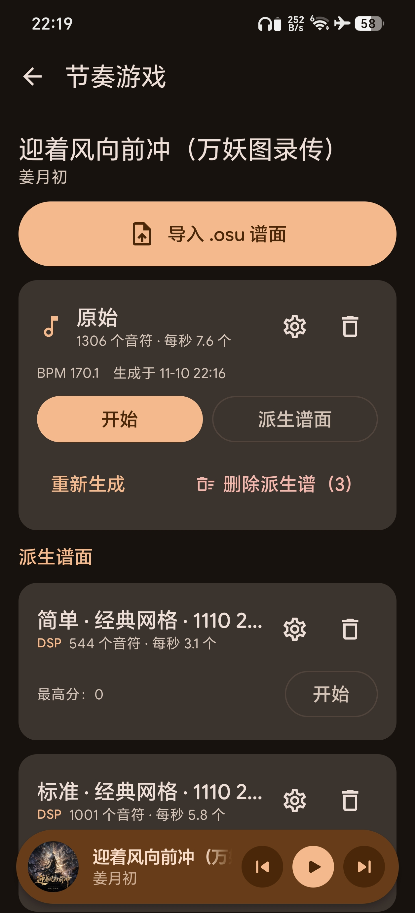
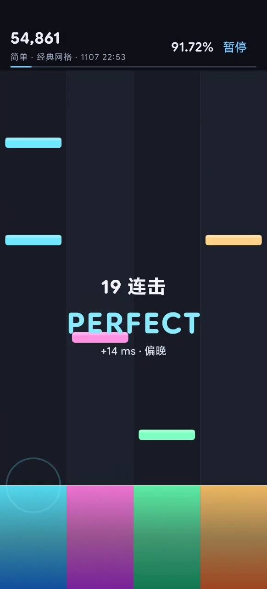

<p align="center">
  
</p>

<p align="center">
  <a href="README.md">English</a> | <b>简体中文</b>
</p>

<p align="center">
  <a href="https://github.com/pisces312/PiscesPlayer/releases/latest">
    
  </a>
  <a href="https://github.com/pisces312/PiscesPlayer/releases">
    
  </a>
  <a href="https://github.com/sponsors/lostf1sh">
    
  </a>
  
  
</p>

<p align="center">
  
  
  
  
  
  
</p>

## 这是什么

PiscesPlayer 是一款带**内置节奏游戏**和 **AI 音乐工具**的 Android 音乐播放器，由 [@pisces312](https://github.com/pisces312) 维护，基于 [@lostf1sh](https://github.com/lostf1sh) 维护的上游开源播放器 [PixelPlayerOSS](https://github.com/PixelPlayerHQ/PixelPlayerOSS)。它专注本地播放、自建音乐库、富有表现力的 Material 3 界面、用户可控的在线查询，并能把任意歌曲变成可玩的节奏谱面。

PiscesPlayer 使用独立包名（`com.pisces312.piscesplayer`）与独立签名，可与上游或 F-Droid 版本的 PixelPlayerOSS 共存安装——见 [Release 构建](#release-构建)。本项目作为独立项目维护，而非持续跟随上游的 fork；与上游的关系及分叉基线见 [PROVENANCE.md](PROVENANCE.md)。

应用默认离线可用；可选在线服务在你于初始设置或设置中开启前保持关闭。

## 亮点功能

### 🎮 节奏游戏 —— 任意歌曲，一键成谱

<p align="center">
  
</p>

在曲库里任选一首歌，即可由音频实时 DSP 生成可玩的四轨谱面：

- **一首歌一份主谱面，难度无限派生** —— Easy / Normal / Hard 全部由主谱面派生，不需重新生成。
- **两种派生路线可自由组合** —— *原声对齐*（不移动任何时间戳，音符与音频完全一致，旋律优先选音）与*拍格网格*（吸附到跟随歌曲真实速度变化的分段网格，同时发生的 onset 合成双音 / 三音）。旧版固定 BPM 行为保留为 **Classic（经典网格）** 模式。
- **开局可选播放逻辑** —— 自适应格点、osu! 式单曲 BPM 吸附、旧版分段拟合、按谱面原样。运行标题会记录所用逻辑，同一首歌可以现场 A/B。
- **手感微调** —— ±10 ms 延迟校准、下落（滚动）时间、延迟补偿，逐谱面保存、即时生效。
- 每种生成 / 派生方式都有 ⓘ 详细说明，中英双语。

### 🤖 AI 音乐工具

<p align="center">
  
</p>

- **AI 歌单** —— 描述心情让 AI 生成歌单，或用**不期而遇（Serendipity）**来一份惊喜混音。请求流式返回，模型的思考过程实时可见，并随歌单保存、随时回看。
- **问歌** —— 以当前歌曲为上下文的对话面板，内置歌曲 / 歌手 / 专辑 / 风格 / 歌词快捷提问，支持流式追问，可一键切换到不带歌曲上下文的通用对话。默认只发送歌曲元数据，歌词按次授权。
- **AI 翻译**歌名与歌词。
- **日语歌词罗马音**标注，词典按需下载。

### 🎧 全功能播放器

- Media3 / ExoPlayer 引擎 + FFmpeg 扩展解码器，无缝播放、淡入淡出、自定义过渡、ReplayGain、睡眠定时、队列控制、随机 / 循环、外部文件播放。
- 曲库：专辑、艺术家、流派、文件夹、收藏、播放列表、听歌统计，以及原位元数据编辑（含写入文件标签的五星评分）。
- 歌词：内嵌歌词、本地 `.lrc`、导入 / 编辑、可选 LRCLIB 查询，以及**车机歌词标题**模式——让只显示「标题 / 歌手 / 专辑」的车机滚动显示当前歌词行。

### 🏠 自建优先

- Navidrome/Subsonic 与 Jellyfin：登录、同步、流媒体、封面、应用私有离线下载。
- 云端播放仅限自建源；其余在线能力（MusicBrainz 匹配、LRCLIB 歌词、Deezer 艺术家图片）只在你主动使用时才运行。

### 🎨 Material 3 界面

- Jetpack Compose、动态取色、亮 / 暗主题、Glance 桌面小组件、动态播放器界面，简体中文完整本地化。

## 功能一览

| 领域 | 亮点 |
| --- | --- |
| 节奏游戏 | DSP 主谱面生成、Easy/Normal/Hard 派生、播放逻辑选择器、延迟校准、下落速度、音符密度 |
| AI | AI 歌单（描述 / 不期而遇）、问歌、歌名与歌词翻译、日语罗马音 |
| 播放 | Media3 引擎、FFmpeg、无缝播放、淡入淡出、自定义过渡、队列控制、随机、循环、睡眠定时、外部文件播放 |
| 曲库 | 本地扫描 MP3、FLAC、AAC、OGG、WAV、M4A，专辑、艺术家、流派、文件夹、收藏、播放列表、统计、元数据编辑 |
| 自建 | Navidrome/Subsonic 与 Jellyfin 登录、同步、流媒体、封面、应用私有离线下载 |
| 歌词 | 内嵌歌词、本地 `.lrc`、导入 / 编辑、可选 LRCLIB 查询、车机歌词标题 |
| 封面 | 本地封面、专辑封面取色、可选 Deezer 艺术家图片查询 |
| 元数据 | 按需 MusicBrainz 匹配 recording / release / artist 标识 |
| 界面 | Jetpack Compose、Material 3、动态取色、亮 / 暗主题、Glance 小组件、动态播放器界面 |
| 备份 | 偏好、播放列表、收藏、歌词、统计、应用状态的备份 / 恢复 |
| 更新 | 应用内更新器对接本 fork 的 GitHub Release，可选每日检查 |

## 性能与优化

- **Baseline profile** 加速启动；R8 只打包实际引用的 `material-icons-extended` 类，APK 明显更小。
- **听歌统计按需计算**并按周期缓存；打开统计页不再重写整份播放历史（过去正是它导致蓝牙播放卡顿）。
- **Compose 稳定性调优** —— strong skipping、显式稳定性配置、`distinctUntilChanged` 状态切片、`ImmutableList` 状态，降低重组成本。
- **节奏游戏时钟漂移恢复**，参考 osu! 的 `InterpolatingFramedClock`：稳定起步、一秒预备、音符始终与音频同步。
- **封面管线加固** —— 并发缓存写入不再互相损坏，服务器错误响应不会被缓存成封面，云端封面卡占位图问题修复（[#138](https://github.com/PixelPlayerHQ/PixelPlayerOSS/issues/138)）。

## 在线服务

PiscesPlayer 把离线播放与网络查询分开。

| 服务 | 用途 | 默认 |
| --- | --- | --- |
| Navidrome/Subsonic | 自建曲库同步、流媒体、离线下载 | 需用户登录 |
| Jellyfin | 自建曲库同步、流媒体、离线下载 | 需用户登录 |
| AI 服务 | AI 歌单、问歌、翻译（用户自备端点） | 需用户配置 |
| MusicBrainz | 按需元数据匹配与标识回填 | 仅主动使用时 |
| LRCLIB | 本地 / 内嵌歌词缺失时在线查找歌词 | 关闭 |
| Deezer | 补全缺失的艺术家图片并本地缓存 | 关闭 |

LRCLIB 与 Deezer 可在首次启动向导中开启，或之后在 `设置 > 音乐管理 > 可选在线服务` 中开启。MusicBrainz 搜索只在你对单曲发起查询时运行。

## 系统要求

| 要求 | 版本 |
| --- | --- |
| Android | 11 及以上，API 30+ |
| JDK | 21 |
| Android SDK | compile/target 37 |

## 从源码构建

克隆仓库：

```sh
git clone https://github.com/pisces312/PiscesPlayer.git PiscesPlayer
cd PiscesPlayer
```

构建 debug APK：

```sh
JAVA_HOME=/usr/lib/jvm/java-21-openjdk ./gradlew :app:assembleDebug
```

构建单个 universal debug APK 便于本地安装：

```sh
JAVA_HOME=/usr/lib/jvm/java-21-openjdk ./gradlew :app:assembleDebug -Ppixelplayer.enableAbiSplits=false
```

构建 universal 未签名 release APK（可用于 F-Droid 校验）：

```sh
JAVA_HOME=/usr/lib/jvm/java-21-openjdk ./gradlew :app:assembleRelease -Ppixelplayer.enableAbiSplits=false -Ppixelplayer.disableReleaseSigning=true
```

运行单元测试：

```sh
JAVA_HOME=/usr/lib/jvm/java-21-openjdk ./gradlew :app:testDebugUnitTest
```

连接设备 / 模拟器生成 baseline profile：

```sh
JAVA_HOME=/usr/lib/jvm/java-21-openjdk ./gradlew :baselineprofile:generateBaselineProfile
```

## 下载

APK 发布在 GitHub Releases 页面：

```text
https://github.com/pisces312/PiscesPlayer/releases
```

Obtainium 应用 id：

```text
com.pisces312.piscesplayer
```

攒够一批改动后从 `main` 发布，没有固定周期。

### Release 构建

Release 由人工从 `main` 切出，以 `X.Y.Z` 发布到 [Releases 页面](https://github.com/pisces312/PiscesPlayer/releases)。没有自动预发布流水线，因此不会发布 `vX.Y.Z-alpha.N` 构建。

安装方式：从 Release 资产下载 APK 侧载；只构建 `arm64-v8a`。

Release 使用个人密钥签名，可相互覆盖升级。PiscesPlayer 使用独立包名与签名，无法覆盖安装 PixelPlayerOSS（上游或 F-Droid）反之亦然；两边迁移曲库使用应用内备份与恢复。

## 支持

PiscesPlayer 是一个业余分支。如果这个播放器对你有用，最好的支持方式是支持上游项目：[@lostf1sh 的 GitHub Sponsors](https://github.com/sponsors/lostf1sh)。

## 项目结构

```text
app/src/main/java/com/pisces312/piscesplayer/
- data/             Room、仓库、偏好、服务、Worker
- di/               Hilt 模块与限定符
- presentation/     Compose 页面、组件、导航、ViewModel
- ui/               主题与 Glance 小组件
- utils/            共享工具

baselineprofile/      Macrobenchmark 与 baseline profile 生成
```

## 技术栈

| 领域 | 技术 |
| --- | --- |
| 语言 | Kotlin |
| UI | Jetpack Compose |
| 设计 | Material 3 |
| 播放 | AndroidX Media3、ExoPlayer、FFmpeg |
| 数据库 | Room |
| 依赖注入 | Hilt |
| 偏好 | DataStore |
| 后台任务 | WorkManager |
| 网络 | Retrofit、OkHttp |
| 图片 | Coil |
| 元数据 | TagLib |

## 参与贡献

欢迎贡献。请开 issue 或提交聚焦的改动，尽量附上测试 / 构建结果。

常用本地检查：

```sh
JAVA_HOME=/usr/lib/jvm/java-21-openjdk ./gradlew :app:compileDebugKotlin
JAVA_HOME=/usr/lib/jvm/java-21-openjdk ./gradlew :app:lintDebug
JAVA_HOME=/usr/lib/jvm/java-21-openjdk ./gradlew :app:testDebugUnitTest
```

发版流程：[docs/RELEASE.md](docs/RELEASE.md)

F-Droid 说明（历史文档，本分支不经 F-Droid 分发）：[docs/FDROID.md](docs/FDROID.md)

隐私政策：[PRIVACY.md](PRIVACY.md)

安全政策：[SECURITY.md](SECURITY.md)

## 许可证

PiscesPlayer 以 [GNU General Public License v3.0](LICENSE) 许可发布（`SPDX-License-Identifier: GPL-3.0-or-later`），是 Theo Vilardo（@lostf1sh）的 [PixelPlayerOSS](https://github.com/PixelPlayerHQ/PixelPlayerOSS) 的修改版本；详见 [NOTICE](NOTICE) 与 [PROVENANCE.md](PROVENANCE.md)。

```
PiscesPlayer
Copyright (C) 2026 pisces312
Based on PixelPlayerOSS, Copyright (C) 2026 Theo Vilardo

This program is free software: you can redistribute it and/or modify
it under the terms of the GNU General Public License as published by
the Free Software Foundation, either version 3 of the License, or
(at your option) any later version.

This program is distributed in the hope that it will be useful,
but WITHOUT ANY WARRANTY; without even the implied warranty of
MERCHANTABILITY or FITNESS FOR A PARTICULAR PURPOSE.  See the
GNU General Public License for more details.

You should have received a copy of the GNU General Public License
along with this program.  If not, see <https://www.gnu.org/licenses/>.
```

分发的 APK 包含按各自许可证发布的第三方组件。其中可选 FFmpeg 解码依赖 `org.jellyfin.media3:media3-ffmpeg-decoder` 为 GPL-3.0；详见 [THIRD_PARTY_NOTICES.md](THIRD_PARTY_NOTICES.md)。

<p align="center">
  PiscesPlayer 由 <a href="https://github.com/pisces312">pisces312</a> 独立维护 · 上游 <a href="https://github.com/PixelPlayerHQ/PixelPlayerOSS">PixelPlayerOSS</a> 由 <a href="https://github.com/lostf1sh">lostf1sh</a> 维护
</p>
<p align="center">
  PixelPlayerOSS 原始 logo 由 <a href="https://github.com/NPSummers">Aureal</a> 设计；PiscesPlayer 图标由 pisces312 设计。
</p>
