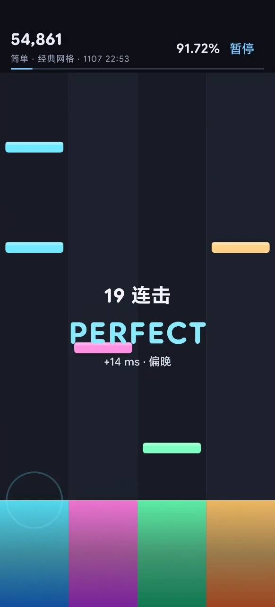
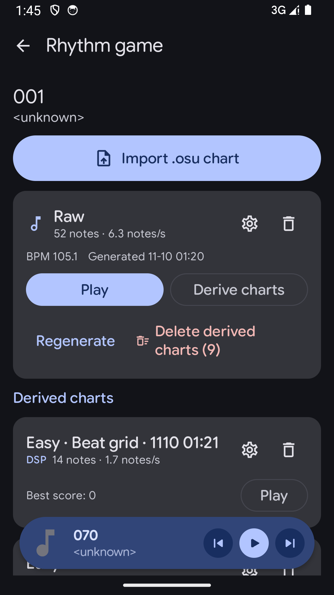
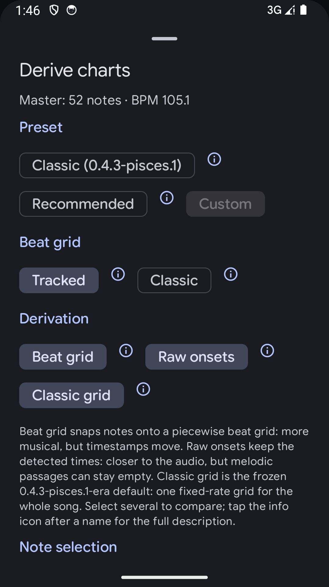
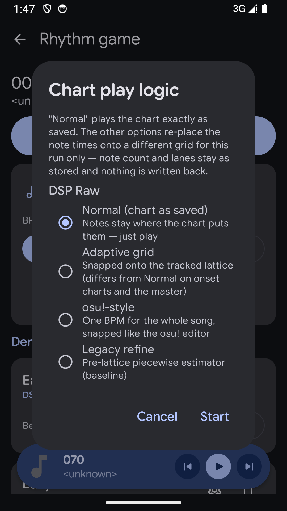
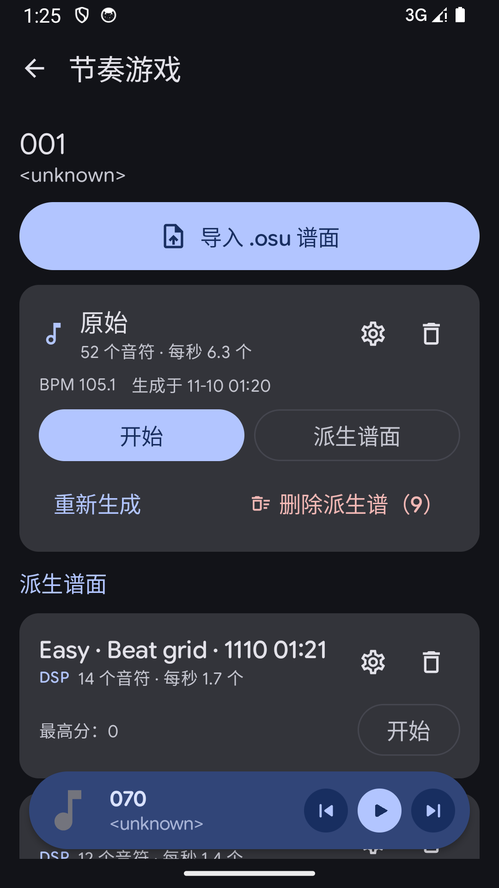
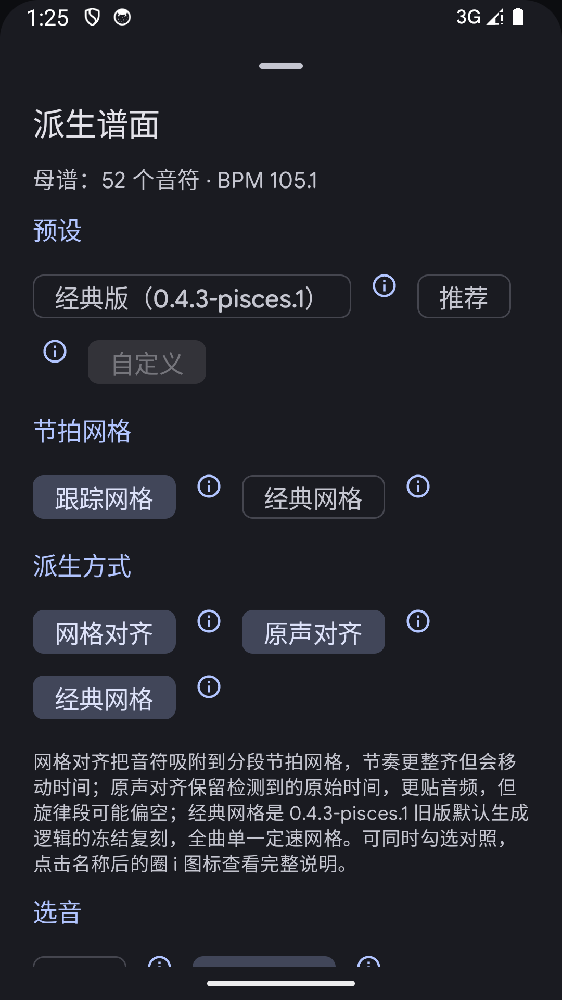
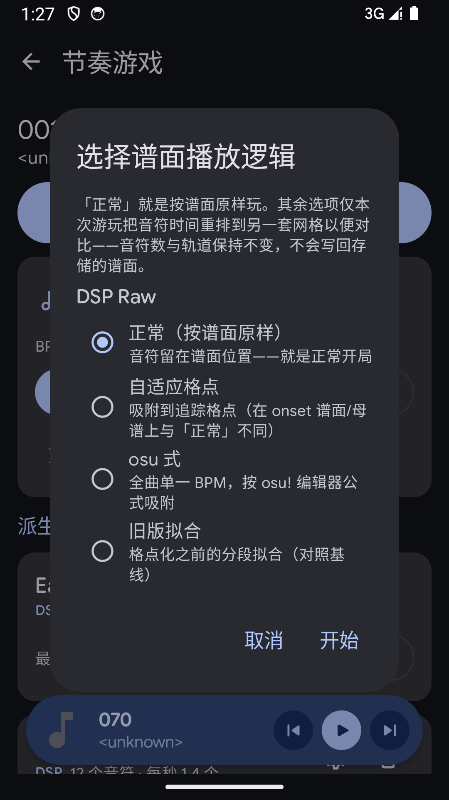

# PiscesPlayer 1.0.0 — a PixelPlayerOSS fork with a rhythm game

**Turn any song in your library into a playable 4-lane rhythm chart with one tap — plus AI music tools, car lyrics, and everything this fork has added over upstream.**

**把曲库里任意一首歌一键生成可玩的四轨节奏谱面 —— 以及 AI 音乐工具、车机歌词，和本 fork 相对上游的全部改动。**

PiscesPlayer is a fork of [PixelPlayerOSS](https://github.com/PixelPlayerHQ/PixelPlayerOSS) (GPL-3.0-or-later, by @lostf1sh). This first release under the new name covers **everything this fork has changed since it diverged**, listed below in importance order (English first, 中文在后). It uses its own package name (`com.pisces312.piscesplayer`) and icon, so it installs side by side with upstream builds.

---

## English

### 1. 🎮 Rhythm game — any song, one tap

Pick any song in your library, open the game from the gamepad action next to the lyrics chip (or from any song info sheet), and a master chart is generated from the audio itself with on-the-fly DSP:

- **One master chart per song, unlimited derived difficulties.** Easy / Normal / Hard are derived from the master chart, never regenerated from scratch.
- **Two derivation families, freely combinable:**
  - **Raw onsets** — no timestamp is ever moved; notes land exactly where the audio says. Melody-first note selection keeps melodic phrases from being crowded out by drums (the default that won the on-device A/B test).
  - **Beat grid** — notes snap to a piecewise beat grid that tracks the song's real tempo changes; Easy/Normal/Hard get 1/1, 1/2 and 1/4 beat slots, simultaneous onsets become double/triple notes.
  - The 0.4.3-era fixed-BPM behavior is preserved as a **Classic** mode for comparison.
- **A play-logic picker at game start** — place the notes with the adaptive grid, an osu!-style single-BPM snap, the legacy piecewise estimator, or exactly as stored. The run title records which logic was used, so you can A/B two placements of the same song.
- **Feel tuning:** latency calibration stepped in ±10 ms without clamping, note-drop (scroll) time, delay compensation — all per chart, applied live.
- A stable start with a one-second lead-in and clock-drift recovery modelled on osu!'s `InterpolatingFramedClock`, so notes stay in step with the audio.
- Import `.osu` charts; every generation and derivation method explains itself behind an ⓘ button, in English and Simplified Chinese.

| | |
|---|---|
| Chart library |  |
| Derivation settings |  |
| Play-logic picker |  |

### 2. 🤖 AI music tools

- **AI playlists** — describe a mood in plain language and the pick is made from your own library, or roll **Serendipity** for a zero-input mix built from right now (weekday, time of day, local weather, today's steps — each signal shown before it is used, never faked). The request streams and the model's thought process is visible while it thinks, then saved with the playlist so it can be read back later alongside the full prompt and sampling. Long-press Serendipity for a one-gesture mix.
- **Ask about the song that is playing** — a conversation sheet with the song attached as context, quick prompts (song / artist / album / style / lyrics), streamed follow-ups, and a one-tap switch to general chat. Sends only song metadata by default; lyrics are opt-in per question.
- **Translate the song title and the lyrics** with AI.
- **Japanese romaji reading** for lyrics, with an on-demand dictionary download.
- Works with any OpenAI-compatible endpoint; three built-in providers (Xiaomi MiMo, Volcano Engine Ark, custom base URL) with per-provider keys and a one-tap model list. API keys never enter a log entry.

### 3. 🚗 Bluetooth car lyric title

The current lyric line is published as the outgoing media title, so head units that can only render Title/Artist/Album — and scroll that title — show lyrics instead of a fixed track name:

- Off by default; active only for Bluetooth A2DP output with synced lyrics, so the notification, lock screen and phone speakers keep the real title.
- A 0–1 s title lead compensates the AVRCP round trip; long lines are split into evenly timed cues instead of being truncated (or sent whole, if your unit scrolls by itself).
- Instrumental placeholder gaps are detected properly — on a real track with 44 blank markers the fallbacks to the song title dropped from 44 to 3.

### 4. 📊 Listening stats that don't stutter

- A top-level tab: recently played grouped by day, absolute period browsing (today / week / month / year / all) with previous-next navigation, an overview card, and full top-song / top-artist / top-album rankings (optionally unlimited), each playable as a queue.
- Stats are computed on demand and cached per calendar period — opening the page no longer rewrites the whole playback history, which is what used to stutter audio over Bluetooth.
- Play-count weighted events; Quick play previews stay out of stats, recently played and AI sampling.

### 5. 🏷️ Metadata

- **MusicBrainz matching** — search and fill recording, release, and artist identifiers on demand.
- **Five-star ratings** — rate anything including cloud tracks, from the player's star row or the song info sheet; un-favouriting keeps the rating.
- **Release date support** — the song sheet shows the release date from the file's own tags, with release-date sorting in the year list.
- Batch metadata edits no longer wipe unrelated tags.

### 6. 📥 Import & backup

- **Poweramp import** — `.poweramp-backup` files with a full preview (songs, playlists, match rate, unmatched examples) before you commit; playlists, play counts, favourites and ratings import independently.
- **Backup / restore** keeps AI and Serendipity playlists and play counts, carries AI provider configuration, and matches songs smartly on restore.

### 7. 🔄 In-app updater

Settings → Updates checks this fork's GitHub releases and installs the newer build over the running one; an optional daily check notifies you (off by default). Builds that cannot replace the running one (debug install, different signing key) are reported with a link to the release page instead of failing. The About screen shows the exact commit and build time of the running build.

### 8. 📚 Library & everyday UX

- Genres tab; Years tab with play, shuffle, sort and year detail screens; a playlist source filter separating AI-generated from hand-built playlists.
- Search history with one-tap re-run; double-tapping the selected bottom navigation entry scrolls back to the top.
- Deletion protection — song deletion is off by default so a mis-tap cannot destroy files.
- In-app diagnostic logs with an adjustable level and one-tap export/share.
- Add-to-playlist from the full player, playlist rename, a collapsible rating pill, and the song info sheet opens on Details from the player title.
- The changelog sheet renders the repository `CHANGELOG.md` at runtime. Simplified Chinese is complete across screens and settings.

### 9. 🛠️ Player fixes

- Cloud album artwork no longer freezes on the placeholder after a few songs ([#138](https://github.com/PixelPlayerHQ/PixelPlayerOSS/issues/138)); server error responses are never cached as covers; concurrent cache writes no longer corrupt each other; System UI can read session artwork again.
- Back closes the player instead of leaving a folder ([#136](https://github.com/PixelPlayerHQ/PixelPlayerOSS/issues/136)); ReplayGain survives queue edits ([#133](https://github.com/PixelPlayerHQ/PixelPlayerOSS/issues/133)); Navidrome uses server created time for date added ([#132](https://github.com/PixelPlayerHQ/PixelPlayerOSS/issues/132)); the compact library title pill no longer renders black ([#134](https://github.com/PixelPlayerHQ/PixelPlayerOSS/issues/134)).
- FLAC playback works again with float output; the player no longer shows the previous song after a track change; mini-player gestures cleaned up (no skip dead zone, vertical drags never skip).
- Search can no longer die permanently after visiting the AI mix screen (a second PlayerViewModel torn down the app-wide search state); deleting playlists cleans up their song rows in one transaction.
- Jellyfin playlists survive 10.10+ mixed-content servers; Media3 1.11.0 `onConnect` regression fixed; playlist restore works on release builds (R8 keep rules) with play counts preserved.

### 10. 🔒 Security

- AI request logs redact `key`, `token` and `secret` parameters before anything reaches disk; API keys never enter a log entry.
- Debug network logs redact credentials.

### 11. 🎨 The rename

PiscesPlayer, package `com.pisces312.piscesplayer`, a new icon, and the version line restarting at 1.0.0 — cleanly separated from upstream builds, which it can coexist with (the debug build has its own id and a red icon). Release builds are signed locally from `KEY_*` environment variables; only `arm64-v8a` ships.

### 📦 Install

| | |
|---|---|
| Android | 11+ (API 30+) |
| ABI | `arm64-v8a` only |
| APK | `piscesplayer-arm64-v8a-1.0.0-release.apk` |
| SHA-256 | `5fc1afbc36c0df9b7bd7037eee092c189ec3da2923bfabfeccec82e9bba17e81` |

**Coming from a PixelPlayerOSS install (0.4.3 and earlier)?** PiscesPlayer is a separate app: export a backup in the old app (`Settings → Backup`), install PiscesPlayer, restore the backup, then uninstall the old app when you are satisfied. Unencrypted backups can be restored directly. Encrypted backups must be restored from `Settings → Backup` after setup (the first-run wizard has no password field). If the backup contains custom artist images, restore them after the first library scan.

### ⚖️ License & attribution

PiscesPlayer is licensed under GPL-3.0-or-later and is a modified version of PixelPlayerOSS by Theo Vilardo (@lostf1sh), who is not responsible for this fork's modifications. See [NOTICE](https://github.com/pisces312/PiscesPlayer/blob/main/NOTICE) and [THIRD_PARTY_NOTICES.md](https://github.com/pisces312/PiscesPlayer/blob/main/THIRD_PARTY_NOTICES.md). If the player is useful to you, consider supporting the upstream project.

---

## 中文说明

PiscesPlayer 是 [PixelPlayerOSS](https://github.com/PixelPlayerHQ/PixelPlayerOSS)（GPL-3.0-or-later，作者 @lostf1sh）的分支。本次以新名字发布的第一个版本汇总了**本 fork 自分叉以来的全部改动**，按重要性排序如下（英文在前，中文在后）。使用独立包名（`com.pisces312.piscesplayer`）与全新图标，可与上游版本共存安装。

### 1. 🎮 节奏游戏 —— 任意歌曲，一键成谱

在曲库里任选一首歌，从歌词旁的手柄图标（或任意歌曲信息面板）进入游戏，即可由音频实时 DSP 生成主谱面：

- **一首歌一份主谱面，难度无限派生**：Easy / Normal / Hard 全部由主谱面派生，不需重新生成。
- **两种派生路线可自由组合**：
  - **原声对齐**：不移动任何时间戳，音符与音频完全一致；「旋律优先」选音让旋律乐句不被鼓点挤掉（实机 A/B 胜出的默认档）。
  - **拍格网格**：吸附到分段拍网格，跟随歌曲真实速度变化；三档难度对应 1/1、1/2、1/4 拍格子，同时发生的 onset 合成双音 / 三音。
  - 0.4.3 时代的固定 BPM 行为保留为 **Classic（经典网格）** 模式，便于对比。
- **开局可选播放逻辑**：自适应格点、osu! 式单曲 BPM 吸附、旧版分段拟合、按谱面原样；运行标题会记录所用逻辑，同一首歌可以现场 A/B。
- **手感微调**：±10 ms 延迟校准不截断、下落时间、延迟补偿，逐谱面保存、即时生效。
- 稳定起步 + 一秒预备，参考 osu! 的 `InterpolatingFramedClock` 做时钟漂移恢复，音符始终跟得上音频。
- 支持导入 `.osu` 谱面；每种生成 / 派生方式都有 ⓘ 详细说明，中英双语。

| | |
|---|---|
| 谱面库 |  |
| 派生设置 |  |
| 播放逻辑 |  |

### 2. 🤖 AI 音乐工具

- **AI 歌单**：用一句话描述心情，从你自己的曲库里选歌；或用**不期而遇（Serendipity）**——零输入，基于当下（星期、时段、当地天气、今日步数）生成混音，每个信号先展示再使用、绝不造假。请求流式返回，模型思考过程实时可见，并随歌单保存、随时回看完整提示词与采样设置。长按不期而遇一键出歌单。
- **问歌**：以当前歌曲为上下文的对话面板，内置歌曲 / 歌手 / 专辑 / 风格 / 歌词快捷提问，支持流式追问，可一键切换到不带歌曲上下文的通用对话。默认只发送歌曲元数据，歌词按次授权。
- **AI 翻译歌名与歌词**。
- **日语歌词罗马音**标注，词典按需下载。
- 兼容任意 OpenAI 兼容端点，内置三家（小米 MiMo、火山方舟、自定义 base URL），密钥按提供商存储、支持一键拉取模型列表；API 密钥绝不进日志。

### 3. 🚗 车机歌词标题

把当前歌词行作为媒体标题发出去，让只显示「标题 / 歌手 / 专辑」并滚动标题的车机显示歌词：

- 默认关闭；仅在蓝牙 A2DP 输出且歌曲有逐行歌词时生效，通知、锁屏、手机扬声器始终保留真实标题。
- 0–1 秒提前量补偿 AVRCP 往返；长句切分为等时片段（也可整行发送，由车机自己滚动）。
- 纯音乐占位空行识别修复：实测 44 个空标记的曲子回退到歌名的次数从 44 降到 3。

### 4. 📊 听歌统计（不再卡顿）

- 顶级底部导航页：最近播放按天分组、绝对周期浏览（今天 / 周 / 月 / 年 / 全部）前后翻页、总览卡、完整歌曲 / 歌手 / 专辑排行（可不限条数），排行可直接当队列播放。
- 统计按需计算并按周期缓存——打开页面不再重写整份播放历史（过去正是它导致蓝牙播放卡顿）。
- 播放事件带次数权重；Quick play 预览不进统计、最近播放与 AI 采样。

### 5. 🏷️ 元数据

- **MusicBrainz 匹配**：按需搜索并回填 recording / release / artist 标识。
- **五星评分**：云端曲目也能评，播放器星级行或歌曲信息面板直接打分；取消收藏保留评分。
- **发行日期**：歌曲面板显示文件标签里的发行日期，年份列表支持按发行日期排序。
- 批量编辑元数据不再误删无关标签。

### 6. 📥 导入与备份

- **Poweramp 导入**：`.poweramp-backup` 文件，导入前完整预览（歌曲、播放列表、匹配率、未匹配示例）；播放列表、播放次数、收藏与评分独立导入。
- **备份 / 恢复**保留 AI 与不期而遇歌单及播放次数，携带 AI 提供商配置，恢复时智能匹配歌曲。

### 7. 🔄 应用内更新

设置 → 更新检查本 fork 的 GitHub Release 并覆盖安装；可选每日检查通知（默认关闭）。无法覆盖安装的构建（debug 包 / 异签名）会给出说明并跳转发布页，而不是失败。关于页显示当前构建的精确 commit 与构建时间。

### 8. 📚 曲库与日常体验

- 流派页；年份页（播放、随机、排序、年份详情）；播放列表来源筛选（AI 生成 / 手动创建分开）。
- 搜索历史一点重跑；双击已选中的底部导航项回到顶部。
- 删除保护——歌曲删除默认关闭，误触不毁文件。
- 应用内诊断日志，级别可调、一键导出 / 分享。
- 播放器内加入播放列表、播放列表重命名、可折叠评分条；点标题直达歌曲详情页。
- 更新日志面板运行时渲染仓库 `CHANGELOG.md`；简体中文覆盖全部界面与设置。

### 9. 🛠️ 播放器修复

- 云端专辑封面不再卡占位图（[#138](https://github.com/PixelPlayerHQ/PixelPlayerOSS/issues/138)），服务器错误响应不会缓存成封面，并发缓存写入不再互相损坏；系统媒体控件恢复读取封面。
- 返回键关闭播放器而不是留在文件夹（[#136](https://github.com/PixelPlayerHQ/PixelPlayerOSS/issues/136)）；ReplayGain 在队列编辑后保留（[#133](https://github.com/PixelPlayerHQ/PixelPlayerOSS/issues/133)）；Navidrome 用服务器创建时间（[#132](https://github.com/PixelPlayerHQ/PixelPlayerOSS/issues/132)）；紧凑库标题药丸不再渲染成黑色（[#134](https://github.com/PixelPlayerHQ/PixelPlayerOSS/issues/134)）。
- float 输出下 FLAC 播放修复；切歌后不再显示上一首；迷你播放器手势整理（无跳过死区、竖滑不切歌）。
- 搜索不会再永久失灵（第二 PlayerViewModel 拆掉全局搜索状态的问题）；删除播放列表同事务清理歌曲行。
- Jellyfin 10.10+ 混合内容服务器播放列表不再丢失；Media3 1.11.0 `onConnect` 回归修复；release 包备份恢复可用（R8 keep 规则），播放次数保留。

### 10. 🔒 安全

- AI 请求日志落盘前脱敏 `key` / `token` / `secret` 参数；API 密钥绝不进日志。
- 调试网络日志脱敏凭据。

### 11. 🎨 全新名字

PiscesPlayer，包名 `com.pisces312.piscesplayer`，全新图标，版本号从 1.0.0 重新起步——与上游构建彻底分开、可共存（debug 包有独立 id 与红底图标）。release 构建用 `KEY_*` 环境变量本地签名；只发 `arm64-v8a`。

### 📦 安装与迁移

| | |
|---|---|
| 系统 | Android 11+（API 30+） |
| ABI | 仅 `arm64-v8a` |
| APK | `piscesplayer-arm64-v8a-1.0.0-release.apk` |
| SHA-256 | `5fc1afbc36c0df9b7bd7037eee092c189ec3da2923bfabfeccec82e9bba17e81` |

**从旧版（0.4.3 及更早的 PixelPlayerOSS 包名）迁移**：PiscesPlayer 是独立应用。先在旧版 `设置 → 备份` 导出备份，安装 PiscesPlayer 后恢复备份，确认无误再卸载旧版。未加密备份可直接恢复；加密备份请在完成初始设置后到 `设置 → 备份` 输入密码恢复（首次启动向导没有密码输入框）。若备份包含自定义艺术家图片，请在首次曲库扫描完成后再恢复一次。

### ⚖️ 许可与署名

PiscesPlayer 以 GPL-3.0-or-later 许可发布，是基于 Theo Vilardo（@lostf1sh）的 PixelPlayerOSS 的修改版本，上游对本分支的修改不负责任。详见 [NOTICE](https://github.com/pisces312/PiscesPlayer/blob/main/NOTICE) 与 [THIRD_PARTY_NOTICES.md](https://github.com/pisces312/PiscesPlayer/blob/main/THIRD_PARTY_NOTICES.md)。如果这个播放器对你有用，欢迎支持上游项目。
